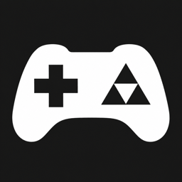
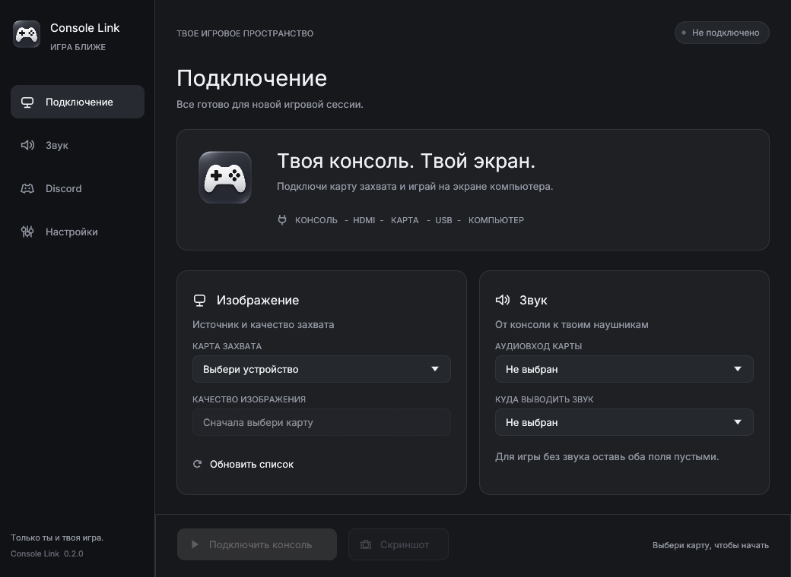

# Console Link



Специализированное desktop-приложение для подключения HDMI-консоли к компьютеру через карту захвата. Rust, macOS и Windows 11, без внешнего медиаплеера и media runtime.



## Скачать 0.3.1

| Платформа | Файл |
|---|---|
| Windows 11 x64 | [Установщик](https://github.com/Potanull/console-link/releases/download/v0.3.1/Console-Link-0.3.1-Setup-x64.exe) |
| macOS Apple Silicon | [Приложение в ZIP](https://github.com/Potanull/console-link/releases/download/v0.3.1/console-link-0.3.1-macos-arm64.zip) |
| Windows x64 без установки | [Portable ZIP](https://github.com/Potanull/console-link/releases/download/v0.3.1/console-link-0.3.1-windows-x64.zip) |

[Страница релиза](https://github.com/Potanull/console-link/releases/tag/v0.3.1) · [SHA256SUMS](https://github.com/Potanull/console-link/releases/download/v0.3.1/SHA256SUMS.txt)

Windows-установщик устанавливает приложение для текущего пользователя, добавляет меню Пуск и штатное удаление. Значок рабочего стола необязателен. Обязательные права администратора не требуются. На Mac распакуй ZIP и перенеси `Console Link.app` в «Программы».

**Предварительный релиз для аппаратной проверки.** Сборка и тесты не подтверждают совместимость конкретной карты, задержку или передачу звука в реальном звонке Discord. Актуальные проверки и ограничения: [docs/validation.md](docs/validation.md).

## Возможности

- Выбор карты и автоматический выбор ее реального режима, по умолчанию до 60 FPS. Full HD имеет приоритет: 1080p30 предпочтительнее 720p60; внутри разрешения выбирается ближайший доступный FPS с учетом лимита. Ручной выбор доступен в настройках.
- Во время игры главное меню сменяется изображением консоли. F1 открывает боковую панель настроек поверх игры. Остановка или закрытие игры возвращает главное меню.
- Обычный оконный режим, окно без рамок и полный экран. Пропорции изображения сохраняются.
- Выбор аудиовхода карты и выхода, громкость, mute, индикатор уровня и коррекция синхронизации от -500 до +500 мс. Отрицательная коррекция добавляет видеозадержку и ограничивается памятью.
- Индикатор громкости поверх игры на 2 секунды при изменении громкости или mute. Курсор скрывается после 4 секунд без движения во время игры; настройки оставляют его видимым.
- Скриншоты PNG без элементов интерфейса.
- Ручное название игры в Discord Rich Presence; интеграция необязательна и не влияет на захват.
- Восстановление после потери ранее подключенного устройства. Ручное отключение отменяет повторы.

## Подключение

1. Switch в док-станции: HDMI OUT дока -> HDMI IN карты; USB data-порт карты -> Mac/PC. Type-C питания не заменяет порт данных.
2. Открой Console Link. Нажми «Обновить устройства», выбери карту. Режим изображения выбирается автоматически; лимит FPS и ручной режим доступны в настройках. Встроенная веб-камера не выбирается автоматически.
3. Для звука выбери **аудиовход карты**, затем наушники/аудиовыход. Приложение не выбирает микрофон автоматически. Оба пустых поля означают видео без звука.
4. Нажми «Подключить консоль». На macOS разреши доступ к камере и аудиовходу. Если после запроса камеры подключение остановилось, нажми подключение повторно.
5. Нажми F1 для настроек поверх игры. Закрытие игрового окна останавливает захват и возвращает главное меню.

Горячие клавиши работают, пока приложение в фокусе:

| Действие | Клавиши |
|---|---|
| Настройки поверх игры | F1 |
| Закрыть панель, выйти из полного экрана или открыть панель | Esc |
| Полный экран | F11, Alt+Enter, Cmd+Enter |
| Переключить режим окна | F10 |
| Скриншот исходного кадра | F8, Ctrl/Cmd+Shift+S |
| Выключить звук | M |
| Громкость с шагом 5% | + / - |
| Остановить сеанс | Ctrl/Cmd+Shift+Enter |

Буквенные клавиши и громкость не срабатывают во время ввода текста. Режим без рамок сохраняет размер окна.

Если карта не появилась ни среди видео-, ни среди аудиоустройств ОС, сначала проверь порт данных, USB-кабель и подключение без хаба. Приложение не может открыть устройство, которое не видит ОС. Черный кадр сам по себе не считается доказательством отсутствия HDMI-сигнала.

## Discord и OBS

Демонстрацию запускает пользователь в Discord: выбери `Console Link - Game` и включи передачу звука. На Mac нужна macOS 13+ и разрешение **для Discord** на запись экрана/системного аудио. В OBS используй захват окна и звука приложения. Работа обоих сценариев должна быть проверена на принимающей стороне.

Громкость/mute влияют на воспроизводимый приложением звук; независимого микшера «для себя / для друзей» нет. Программа не создает виртуальный аудиодрайвер и не управляет Discord Go Live.

Для игрового статуса открой раздел Discord и нажми «Подключить Discord». В браузере разреши доступ к основному профилю, затем вернись в приложение. Введи название игры и включи показ активности. Настольный Discord должен работать под тем же аккаунтом; передача активности должна быть включена. Application ID уже настроен, Client Secret и bot token не нужны. Refresh token хранится в Keychain/Credential Manager. Подробности: [docs/discord-auth.md](docs/discord-auth.md).

Название игры помещается в details; верхнее название активности - Console Link. Автоматического распознавания игры пока нет. Предложение для будущей версии: локальное распознавание текста на HOME/титульном экране с подтверждением пользователя, выключенное по умолчанию. Произвольный геймплей не дает надежного идентификатора игры.

Боковая панель попадет в демонстрацию окна Discord/OBS. Скриншоты сохраняют только исходный кадр консоли.

## Сборка

Rust stable, системный SDK и компилятор: Xcode Command Line Tools на Mac; Visual Studio Build Tools с Desktop development with C++ на Windows.

```sh
cargo run --locked
cargo run --locked -- --list-devices
cargo test --locked
cargo clippy --locked --all-targets -- -D warnings
```

macOS Apple Silicon:

```sh
rustup target add aarch64-apple-darwin
bash scripts/package-macos.sh
open "dist/Console Link.app"
```

Пакет подписан локальной ad-hoc подписью, без Apple notarization. Это тестовая поставка, не notarized релиз.

Windows 11 x64:

```powershell
cargo build --locked --release --target x86_64-pc-windows-msvc
.\target\x86_64-pc-windows-msvc\release\console-link.exe
```

GitHub Actions собирает обе платформы, проверяет Windows install/uninstall в одноразовом каталоге и публикует готовые файлы в Releases при ручном запуске публикации. Windows-установщик не подписан сертификатом разработчика, Mac-пакет без notarization. Intel Mac и Windows ARM в первую проверяемую матрицу не входят.

## Внутреннее устройство

AVFoundation и Media Foundation принимают видео; CPAL использует CoreAudio/WASAPI для аудио. eframe/wgpu переключает меню и игру в одном окне. Первая версия копирует BGRA в RGBA на CPU и загружает GPU-текстуру; zero-copy не заявляется. Очереди ограничены. Подробный проект: [docs/architecture.md](docs/architecture.md), [план](docs/superpowers/plans/2026-11-09-console-link.md).

Настройки локальные, телеметрии и собственного сервера нет. Необязательный вход обращается к OAuth/API Discord; активность передается через локальный IPC настольного Discord. Скриншоты по умолчанию сохраняются в `Pictures/Console Link` или штатной папке изображений пользователя.

Лицензия собственного кода: MIT. Зависимости имеют свои лицензии; см. [THIRD_PARTY.md](THIRD_PARTY.md) и Cargo.lock.
