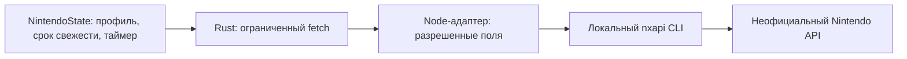

# Аудит Console Link, 13 ноября 2026

Console Link получает видео и звук карты захвата, показывает игровое окно и передает выбранную игру в Discord. Аудит рассчитан на один desktop-процесс и одного пользователя: Full HD, короткие очереди кадров, необязательный опрос Nintendo раз в минуту. Серверная многопользовательская архитектура здесь не нужна.

Проверен код от `665512d` и исправления в ветке `codex/audit-nintendo`. Это аудит с точечными исправлениями, а не полная переработка приложения.

## Что уже сделано качественно

- `capture/history.rs`, `capture/session.rs`, `audio/mod.rs`: ограниченные буферы, предпочтение свежих кадров, защита от бесконечного накопления задержки.
- Нативные ресурсы захвата принадлежат рабочим потокам. Поздний результат подключения проверяется по поколению и признаку отмены. Калиброванный AVFoundation-путь из 0.6.1 сохранен.
- `settings/mod.rs`: атомарное сохранение, проверка схемы, защита от перезаписи настроек более новой версии.
- `discord/auth.rs`: PKCE, проверка state и loopback callback, ограниченные ответы и таймауты, хранение refresh token через системное хранилище. Тесты проверяют отмену и ротацию токенов.
- `scripts/nintendo-presence.cjs` и `nintendo.rs`: фильтрация ответа SDK перед передачей приложению и независимая проверка внешнего протокола в Rust. Это разные границы доверия, их нельзя объединять удалением одной проверки.

## Обязательно исправить

### 1. Медленное обнаружение звука задерживало готовое видео

**Место:** `src/app/session.rs`, `src/app/mod.rs`.

**Что происходит:** видеокарты уже найдены, но интерфейс получал весь результат только после двух вызовов обнаружения аудио. Ранее аппаратный журнал показал около 30 секунд в обнаружении аудио. Обычное подключение без звука тоже ждало этот этап.

**Исправлено:** видео и аудио публикуются независимо. Готовое видео можно подключить без звука. Если пользователь выбрал аудиопару, приложение ждет ее обнаружения и не отключает звук молча. Для каждого типа поиска остается не более одного рабочего потока. Условия готовности кнопки и повторного подключения теперь общие.

**Проверка:** тест удерживает аудиопоиск на канале и получает видеорезультат до его освобождения. Другие тесты проверяют независимость ошибок, сохранение выбранных устройств и ожидание выбранной аудиопары.

**Если оставить:** готовая карта выглядит недоступной из-за несвязанного системного вызова звука.

## Стоит исправить

### 2. Nintendo зависела от PATH терминала

**Место:** `src/nintendo.rs`, раздел Nintendo в `README.md`.

**Что происходит:** `Command::new("node")` не находит Node при ограниченном PATH desktop-приложения, даже если Node установлен в `/usr/local/bin/node` или `/opt/homebrew/bin/node`.

**Исправлено:** на Mac сначала используется PATH, затем стандартные каталоги установщиков. Проверяется доступ текущего пользователя к исполнению файла через `access(X_OK)`, включая ACL. На Windows сохранен прежний механизм поиска. Shell не запускается.

**Проверка:** синтетические PATH/fallback-тесты. Независимое ревью дополнительно воспроизвело ошибку первоначальной проверки `mode & 0o111`: файл с правами `0610` принимался, хотя владельцу запрещен запуск. Финальный тест отклоняет `0610` и каталог, принимает `0700`.

**Если оставить:** Nintendo предлагает установить уже установленный Node; автоматический статус не работает.

### 3. Выбор Nintendo-профиля расходился с политикой игрового таймера

**Место:** `src/app/nintendo.rs`, `src/app/playback.rs`, `src/app/presentation.rs`, `src/app/pages.rs`.

**Что происходит:** обработчик выбора профиля безусловно очищал игру. При выборе другого профиля с той же игрой следующий опрос устанавливал ее заново и сбрасывал таймер. Формирование игрового заголовка было скопировано в четырех местах; ручной выбор пустого названия использовал отдельный вариант.

**Исправлено:** выбор профиля сразу вычисляет игру по свежему состоянию через один метод. Неизменившееся название сохраняет таймер; отключение, просроченные данные и отсутствие подходящей игры очищают его. Все четыре пути используют общий игровой заголовок, включая вариант без названия.

**Проверка:** смена двух синтетических профилей с одной игрой сохраняет время; отключение очищает игру. Сохранены тесты истечения срока и ошибки. Общий заголовок проверен для пустого и обычного названия.

**Если оставить:** Заголовок окна временно теряет название, а игровой таймер в Discord начинает отсчет заново без смены игры.

### 4. График называл входящими кадры после очереди интерфейса

**Место:** `src/app/monitoring.rs`, счетчик в `src/app/session.rs`.

**Что происходит:** счетчик увеличивается при чтении интерфейсом очереди. Очередь может удалить старые кадры при перегрузке. Поэтому график не доказывает частоту входа карты или сигнала HDMI.

**Исправлено:** метрика подписана как кадры, принятые интерфейсом. Ее смысл пояснен рядом. Дополнительный счетчик или новый механизм измерений не добавлен.

**Проверка:** сопоставлен путь `FrameSink -> send_latest -> frames_rx -> self.fps`; вычисление и его стоимость не изменены.

**Если оставить:** остановка UI выглядит как падение FPS карты и направляет диагностику не в тот участок.

### 5. Очистка имен EQ-пресетов расходилась с цветовой

**Место:** `src/settings/mod.rs`, `src/app/equalizer.rs`, существующий `color::preset_name`.

**Что происходит:** EQ при загрузке сначала обрезал пробелы, затем удалял управляющие символы. Имена `"A"` и `"\u0000 A"` превращались в `"A"` и `" A"`, обходя проверку дублей. Редактор EQ использовал только `trim`.

**Исправлено:** загрузка и редактор EQ используют уже существующую очистку имен цветовых пресетов. Проверка дублей выполняется после нормализации. Нового вспомогательного модуля нет.

**Проверка:** тест сначала получил два пресета вместо одного, после исправления проходит. При совпадении очищенных имен сохраняется первый пресет, как в существующей политике цветовых пресетов. Сам файл пользовательских настроек аудит не изменял.

**Если оставить:** одинаковые по смыслу имена появляются в списке и ведут себя иначе после сохранения или загрузки.

## Небольшие упрощения

### 6. Версия Nintendo User-Agent была зашита отдельно

**Место:** `src/nintendo.rs`, `scripts/nintendo-presence.cjs`.

**Что происходит:** адаптер продолжал отправлять `ConsoleLink/0.6.0` независимо от версии сборки.

**Исправлено:** Rust передает версию пакета, JS формирует ограниченный User-Agent. При некорректном значении используется `ConsoleLink`. Состав возвращаемых данных не расширен.

**Проверка:** Node-тест версии, некорректного ввода и безопасного значения по умолчанию.

**Если оставить:** каждую смену версии нужно отдельно повторять в адаптере; диагностика получает неверную версию клиента.

## Nintendo: что остается ограничением

Текущий путь:



Это необязательный внешний адаптер, а не полностью встроенная Nintendo-интеграция. Нужны установленный Node, настроенный локальный nxapi и второй аккаунт, который видит основной профиль среди друзей. Пароли и данные авторизации остаются у nxapi.

Просто переписать запуск на Rust недостаточно: потребуется заново поддерживать неофициальную авторизацию и протокол Nintendo. Прямой разбор сырого ответа SDK в приложении также изменит существующую границу приватности. Для текущего объема это больше кода и риска, а не устранение зависимости.

Рекомендация: сохранить узкий адаптер, общие правила выбора игры и понятные сообщения о недоступности. Не добавлять второй способ авторизации, сервис-посредник или новую систему распознавания в рамках этого аудита. Ручной выбор игры и отключение Nintendo сохранены.

Ограничение завершения процессов: внутренний nxapi ограничен 40 секундами, внешний процесс - 50. Принудительное завершение всего дерева процессов при аварии отдельно не проверялось. Реальный сбой этого механизма аудит не воспроизвел.

## Проверки

- 94 библиотечных и 39 прикладных Rust-тестов прошли без сети и оборудования.
- 5 Node-тестов протокола прошли.
- Clippy со строгими предупреждениями прошел для Mac и Windows GNU.
- Форматирование и `git diff --check` прошли.
- Независимое ревью проверило поиск Node, выбор игры, нормализацию, независимое обнаружение устройств и повторное подключение. Найденный дефект прав исполнения исправлен и покрыт тестом.
- Новые зависимости и изменение формата настроек не потребовались.

Команда Rust-проверки исключала GPU-тесты, тест с локальной авторизацией nxapi и старый тест, создающий `node_modules`-фикстуру:

```sh
cargo test --offline --lib --bin console-link -- \
  --skip app::color_gpu::tests --skip app::upscale_gpu::tests \
  --skip repository_helper --skip live_local_helper
node --test scripts/nintendo-presence.test.cjs
cargo clippy --offline --all-targets -- -D warnings
cargo clippy --offline --all-targets --target x86_64-pc-windows-gnu -- -D warnings
```

## Вердикт и границы

Ядро приложения не требует переписывания. Основная ценность этой правки - устранение задержки обнаружения видео, надежный поиск Node из Mac-приложения и единые правила там, где они уже разошлись.

Сокращены дубли заголовка окна, готовности устройств и очистки имен. Общий diff вырос из-за независимого обнаружения и регрессионных тестов; сокращение общего числа строк не заявляется. Зависимости: без изменений.

Не проверены реальные Nintendo/Discord-аккаунты, авторизация nxapi, оборудование, новые GPU-прогоны, Windows MSVC и установка нового пакета. Исключенные каталоги и пользовательские данные не исследовались. Шейдеры и весь исторический код построчно не аудировались. В сборке остается предупреждение транзитивной зависимости `block 0.1.6` о будущей совместимости Rust; обновление нативных зависимостей требует отдельной проверки оборудования.

Новый релиз этот аудит не выпускает. Установленная версия приложения не заменялась.
